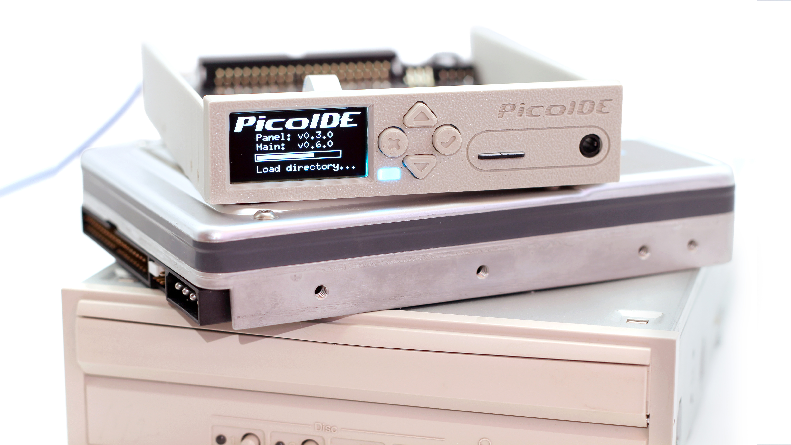
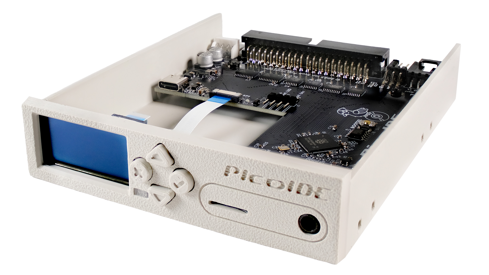
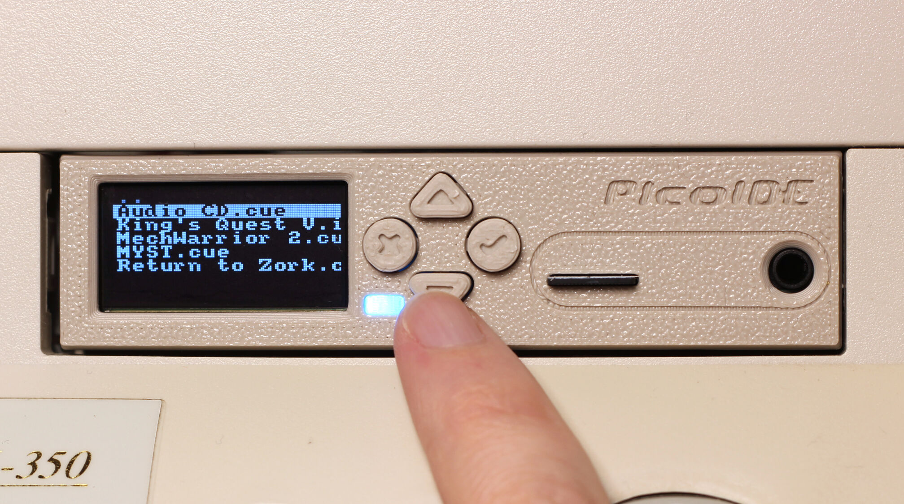
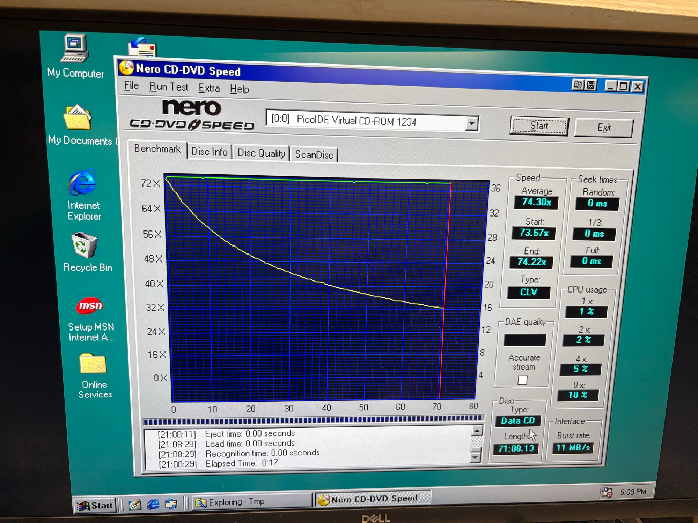
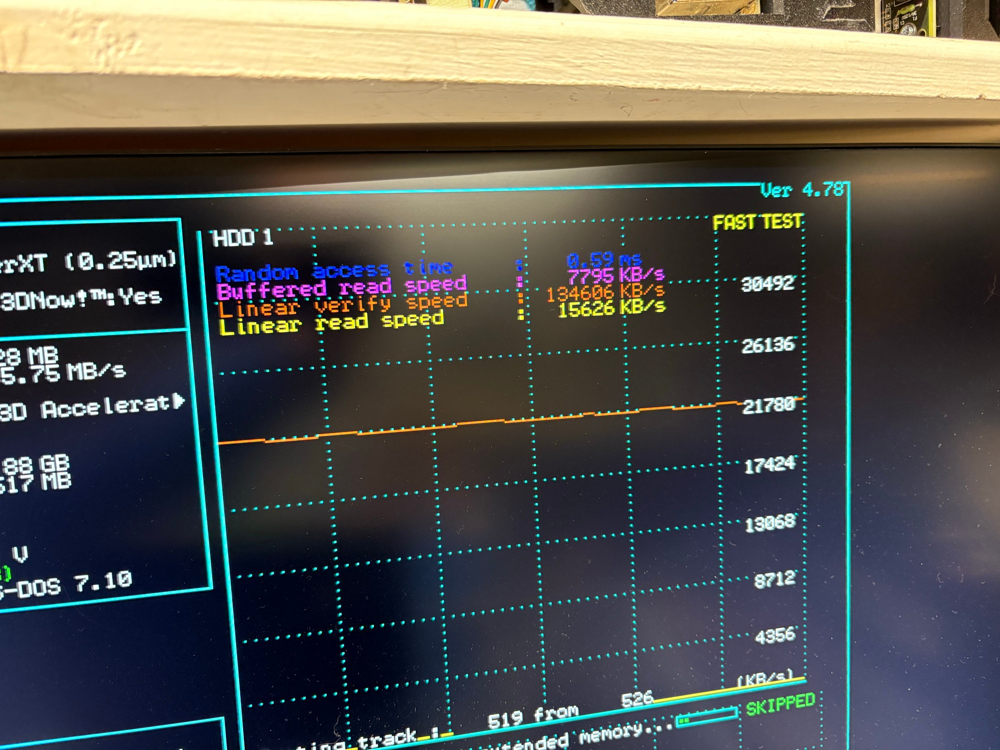

{ .home-logo }

An open IDE/ATAPI drive emulator
{ .home-tagline }

PicoIDE is in preorder at Crowd Supply! 
[Preorder and check on the latest fulfillment updates there.](https://www.crowdsupply.com/polpotronics/picoide)

PicoIDE is a device that emulates IDE/ATAPI devices developed by Ian Scott, creator of [PicoGUS](https://picog.us).
{ .home-intro }

- Fully open source firmware and hardware
- Emulates ATAPI CD-ROM and IDE fixed hard drives
    - .bin/.cue or .iso image support for CD-ROM
    - .img/.hda/.vhd/.hdf for HDD
- Built-in CD audio output on 3.5" jack and MPC-2 header
- Supports PIO modes 0-4 and multi-word DMA modes 0-2
- Optional front panel/3.5" drive bay enclosure with:
    - 1.3" 128x64 OLED screen &amp; 4-way navigation buttons
    - WiFi for remote control and upload/management of disk images
    - RGB activity LED

[Get started](docs/getting-started.md){ .md-button .md-button--primary }
[Download firmware](releases.md){ .md-button }

## Follow for progress updates

[PicoIDE on Crowd Supply](https://www.crowdsupply.com/polpotronics/picoide){ .md-button }
[Open Retro Storage Discord](https://discord.gg/S5hBmjy3yr){ .md-button }
[@polpo.org on BlueSky](https://bsky.app/profile/polpo.org){ .md-button }
[@polpo@chaos.social on Mastodon](https://chaos.social/@polpo){ .md-button }

## Frequently Asked Questions

???+ question "Can PicoIDE emulate more than 1 drive at a time?"
    PicoIDE can emulate two drives at once in "dual mode": a hard drive and optical drive, two hard drives, or two optical drives. See [Dual-Device Mode](docs/getting-started.md#dual-device-mode) in the documentation for more info.

???+ question "Can you add [hardware feature]?"
    The current hardware design is locked in, but who knows what the future may bring.

???+ question "Will PicoIDE work in my device?"
    The primary development/testing platform for PicoIDE is 90s-era PCs, but PicoIDE has a high level of compatibility with the ATA and ATAPI standards, so there's a good chance it will work in your device. If your device is particularly finicky, that sounds like a fun development challenge!

???+ question "What about UDMA support?"
    In the interest of limiting development scope for the first release, PicoIDE's hardware doesn't support UDMA, but faster systems are very well served in the area of fast HDD replacements by CF, SD, and M.2 to IDE adapters, and for optical, PicoIDE's MWDMA mode 2 and PIO mode 4 support can be as fast as a 100X CD-ROM drive, plenty for fast systems.

???+ question "Will there be a 5.25\" or 2.5\" version?"
    PicoIDE will launch with a 3.5" enclosure only, but depending how things go, other form factors may be made available.

???+ question "When will PicoIDE be available?"
    PicoIDE is [available for preorder at Crowd Supply.](https://www.crowdsupply.com/polpotronics/picoide) It is currently set to ship by January 2027.

???+ question "Where will I be able to purchase a PicoIDE?"
    As said above, PicoIDE is [in preorder at Crowd Supply](https://www.crowdsupply.com/polpotronics/picoide), and other suppliers will carry PicoIDE once the campaign is complete.
